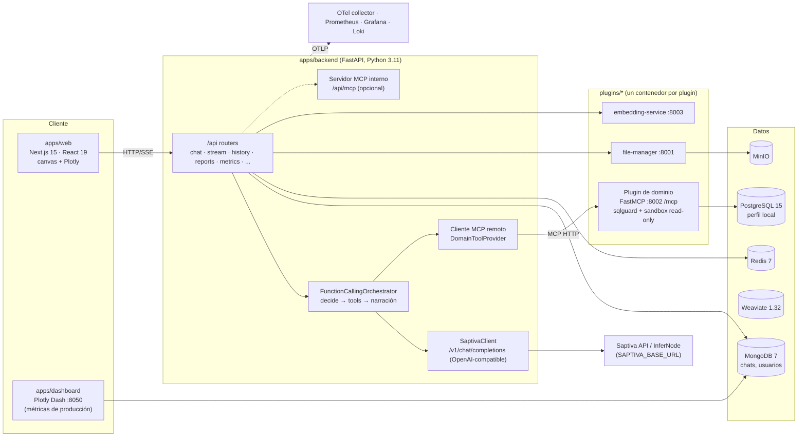
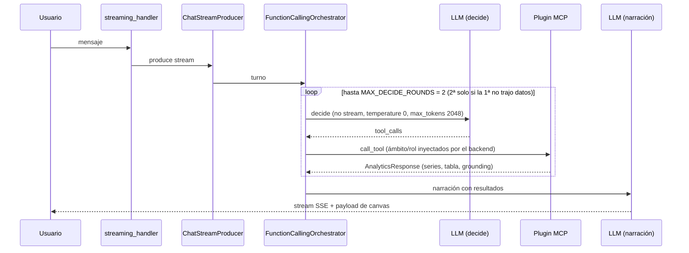

# Current State: arquitectura actual de Octavius

Auditoría de solo lectura, hecha el 2026-11-10.

- **Repo base:** una variante interna de Octavius (`octavios-chat`), en el commit `b0a8dd6`.
- **Alcance:** el fork open source del laboratorio **no incluirá** datos, documentos ni código específicos de ese cliente (ver §13). Este documento describe la plataforma y el dominio retail aparece solo como ejemplo del patrón de plugin.
- **Rutas:** todas son relativas a la raíz de ese repo.
- **Verificación:** las afirmaciones marcadas ✔ las comprobé directamente en el código. Las demás vienen de la auditoría asistida y llevan su ruta para revisarlas.

## 1. Vista general

## 2. Frontend

- **Stack:** Next.js ^15.5 con App Router, React 19, Bun y Tailwind (`apps/web/package.json`).
- **Rutas:** las vistas viven en `apps/web/src/app/` (`chat`, `history`, `reports`, `research`, `(auth)`, `api`, entre otras).
- **Punto de extensión para visualizaciones** ✔: `apps/web/src/components/canvas/charts/canvas-chart-registry.tsx`. Este registro elige el componente de gráfica según `analytics.chart_type`.
  - Componentes genéricos que se pueden reutilizar: `PlotlyChartView.tsx`, `EditorialTable.tsx` y `plotly-runtime.ts`.
  - El resto de los componentes son de dominio retail y no se reutilizan.
- **Segundo frontend:** `apps/dashboard` está hecho en Plotly Dash con Flask, escucha en el puerto 8050 y lee las métricas de uso desde Mongo.

## 3. Backend y puntos de entrada

- FastAPI, con `create_app` en `apps/backend/src/main.py:207`.
- Los routers se montan bajo `/api`: auth, health, chat, intent, stream, history, conversations, reports, metrics, settings, models, features, files, documents, feedback, artifacts y `internal`.
- El MCP de administración es opcional y vive en `/api/mcp` (`main.py:299-316`).

## 4. Runtime del agente y orquestación

**Recorrido de un turno:**

**Características:**

- **No es un loop agéntico abierto** ✔. `MAX_DECIDE_ROUNDS = 2` está en `apps/backend/src/services/streaming/function_calling.py:36`.
  - Las fases decide y narración pueden usar modelos distintos (`decide_model` y `modelo_para_narrar`).
  - El backend inyecta en los argumentos de las tools el ámbito y el rol del usuario, y estos valores sobrescriben lo que proponga el LLM.
  - Cuando una tool falla, el orquestador agrega avisos de sistema.
- **Límites:**
  - `CHAT_MAX_RESPONSE_TOKENS`, con default 3000.
  - Timeouts del cliente LLM: 10 s de conexión y 120 s de lectura.
  - `RETAIL_ADVISOR_TIMEOUT_S`, con default 90 s.
  - Las tools descubiertas se guardan en una caché con TTL.

## 5. Integraciones LLM

- Hay un solo cliente: `SaptivaClient` (`apps/backend/src/services/saptiva_client.py`), basado en httpx y **compatible con OpenAI**. Usa `/v1/chat/completions` y `/v1/models`.
- La URL base sale de `SAPTIVA_BASE_URL`, con default `https://api.saptiva.com`, y puede apuntar a InferNode (`core/config.py:301-330`).
- El modelo por defecto es "Saptiva Turbo". Hay una lista de modelos permitidos y escalamiento automático a otro modelo.
- **No hay clientes nativos de Ollama ni vLLM.** Como el cliente es OpenAI-compatible, basta con apuntar `SAPTIVA_BASE_URL` a un servidor local. Falta verificarlo en la fase 2 (parámetros extra como `chat_template_kwargs`).

## 6. Plugins y herramientas

- **Modelo:** cada plugin es un **servicio independiente** con su Dockerfile y lo descubre el backend.
- **Plugins actuales:**

| Plugin | Protocolo | Puerto |
|---|---|---|
| `plugins/public/file-manager` | HTTP y gRPC | 8001 / 50052 |
| `plugins/public/embedding-service` | HTTP y gRPC | 8003 / 50053 |
| Plugin de dominio (retail) | MCP sobre HTTP con FastMCP ✔ (`src/main.py:83`) | 8002 |

- **Contrato de una tool de dominio:**
  - Se declara con `@mcp.tool()` y argumentos tipados con `Annotated[..., Field]`.
  - Devuelve un `AnalyticsResponse` genérico con `metric_name`, `series`, `table_data`, `response_text`, `chart_type` y `grounding`.
  - Las métricas se declaran en un catálogo YAML.
- **Acoplamiento** ✔: el backend está cableado a **un solo** plugin de dominio.
  - `apps/backend/src/mcp_integration/clients/domain_tools.py:58` fija `ANALYTICS_TOOL = "retail_analytics"`.
  - En la línea 61 usa `get_retail_advisor_client()`.
  - La URL por defecto es `http://retail-advisor:8002/mcp/mcp`.

## 7. MCP

- **Cliente:** `apps/backend/src/mcp_integration/clients/` (`remote_mcp_client.py` sobre `fastmcp.Client`).
- **Servidor interno:** `mcp_integration/server.py`, con su registro, registro lazy, versionado y `security.py`.
- **Uso:** la integración entre el runtime y los plugins de dominio **ya es MCP**. Es la frontera natural para el laboratorio.

## 8. PostgreSQL y acceso SQL de agentes

- **Despliegue:** PostgreSQL 15-alpine en `infra/docker-compose.yml`, solo con `profiles: ["local"]` ✔. Hoy solo lo usa el plugin de dominio. Los datos de la aplicación (chats, usuarios) viven en MongoDB.
- **Migraciones:**
  - En Postgres son scripts SQL sueltos, aplicados con un script Python y sin Alembic.
  - Los de Mongo están en `scripts/migrations/`.
- **Controles reutilizables en el plugin de dominio:**
  - `sqlguard/` ✔ (`ast_validator.py`, `policy.py`, `cost_gate.py`): valida el AST con SQLGlot, aplica una allowlist de vistas, columnas y funciones, y fuerza un LIMIT.
  - `sandbox_executor.py`: transacciones `readonly=True`.
  - `repository.py`: `default_transaction_read_only` y `statement_timeout` por consulta.
- **No verificado:** que exista un `CREATE ROLE` de solo lectura con timeout a nivel de rol.

## 9. Autenticación y autorización

- JWT de acceso y refresh con PyJWT (`services/auth_service.py`), más `middleware/auth.py` y `middleware/rate_limit.py`.
- Los roles de negocio de dominio están en `services/perfil_usuario.py` y no se reutilizan.
- **No verificado:** RBAC granular por endpoint.

## 10. Telemetría, trazas y evaluación

- **Instrumentación:** OpenTelemetry para FastAPI, httpx y logging (`apps/backend/requirements.txt`, `middleware/telemetry.py`), con logs structlog.
- **Stack en `infra/observability/`:** OTel collector, Prometheus con alertas, Grafana y Loki/Promtail.
- **No hay Langfuse** ni trazas por span orientadas a evaluación.
- **Evals existentes** en `apps/backend/tests/evals/`:
  - Runner de enrutamiento: decide, tool y narración contra el plugin real. Los casos YAML definen `tool_esperada`, `texto_contiene` y `grounding_esperado`.
  - Examen por escalera: tamiz, pila dev y pila sellada, con pass^k y bootstrap pareado.
  - Simulador de usuario: persona LLM, chat medido y juez LLM. El evaluador usa un proveedor configurable aparte (`SIM_EVAL_BASE_URL`), así que el juez no es el mismo modelo que se evalúa.
  - Compuerta determinista de grounding en CI.
  - Los resultados se guardan en JSONL y **no hay UI para verlos**.
- **Reutilizable:** los patrones y la metodología son agnósticos al dominio. Los casos, las personas y los datos son del cliente y no se copian.

## 11. Visualización de resultados

| Canal | Qué muestra | Para evals |
|---|---|---|
| Canvas web (registro por `chart_type`) | Resultados de tools en el chat | Reutilizable para gráficas de forecast |
| Dashboard Dash | Uso del producto | No |
| Grafana | Infraestructura | Sirve para latencia y recursos |

No existe un dashboard comparativo de evaluaciones.

## 12. Contenedores y despliegue

- **Compose:** `infra/docker-compose.yml` es el base, con overlays dev, production, images y registry. La red se llama `octavios-network`.
- **Servicios:** mongodb, redis, minio, weaviate, backend, web, nginx, postgres (perfil local), los plugins y dashboard.
- **GPU:** **no hay servicios con GPU** en los compose (no aparece `nvidia` ni `gpus`).
- **CD:** existe `.github/workflows/cd.yml`, pero no está revisado.

## 13. Pruebas y convenciones

- **Pruebas:**
  - Backend y plugins: pytest y ruff.
  - Web: Jest, `next lint` y `tsc`.
  - End-to-end: Playwright.
- **Make:** `make test T=api|web|mcp|e2e` y `make pre-deploy`.
- **CI:** `.github/workflows/ci.yml` corre detección de cambios, Trivy, ruff con unit tests, typecheck y tests de la web, y la compuerta de grounding.
- **Commits:** Conventional Commits, con el cuerpo en español en las secciones Implementación / Logros / Testing / Siguientes pasos, y sin `Co-Authored-By`.

## 14. Material que no debe entrar al fork open source

**Contenido de cliente que se excluye:**

- El plugin de dominio retail completo: ETL, manifiestos, layouts y casos de evals.
- `referencias/`, que ya está fuera de git.
- `docs/` con transcripciones, brief, roadmap y kanban del cliente.
- Los evals, personas y scripts de layout del cliente.
- Los componentes de gráficas retail.
- Los roles de negocio.
- Las opciones `retail_advisor_*`.
- Restos de dominios anteriores: bank-advisor y multi-bank.

**Historial:**

- El historial git contiene material de clientes. Hay PDFs de otro cliente ya destrackeados que siguen en commits viejos.
- **Decisión:** el laboratorio parte de un **snapshot sin historial**, se escanea con gitleaks antes del primer push y se revisa a mano con grep de nombres de cliente.

## 15. Resumen para el laboratorio

| Capacidad | Estado | Para el laboratorio |
|---|---|---|
| UI de chat con canvas de gráficas | Existe | Reutilizar |
| Orquestador decide/tools/narración | Existe, con rondas fijas | Extender: configuración de harness |
| Cliente LLM OpenAI-compatible | Existe | Reutilizar, apuntándolo a un servidor local |
| Plugin MCP con contrato `AnalyticsResponse` | Existe, un solo plugin cableado | Extender: registro de N plugins |
| SQL guard con sandbox de solo lectura | Existe en el plugin retail | Extraer a un módulo compartido |
| PostgreSQL | Existe, perfil local | Reutilizar el servicio y agregar un esquema propio |
| OTel, Prometheus y Grafana | Existe | Reutilizar para latencia y recursos |
| Runner de evals con juez separado | Existe, acoplado al dominio | Generalizar |
| Dashboard de evals | No existe | Construir sobre el canvas y el App Router |
| Inferencia local con GPU | No existe | Agregar como servicio opcional |
