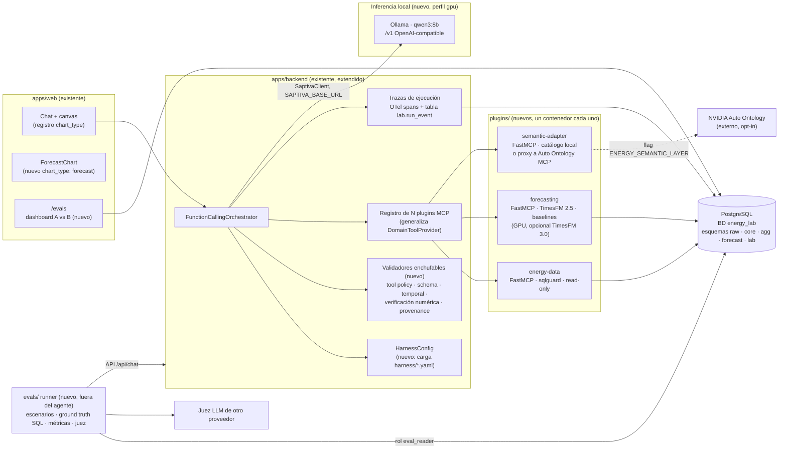
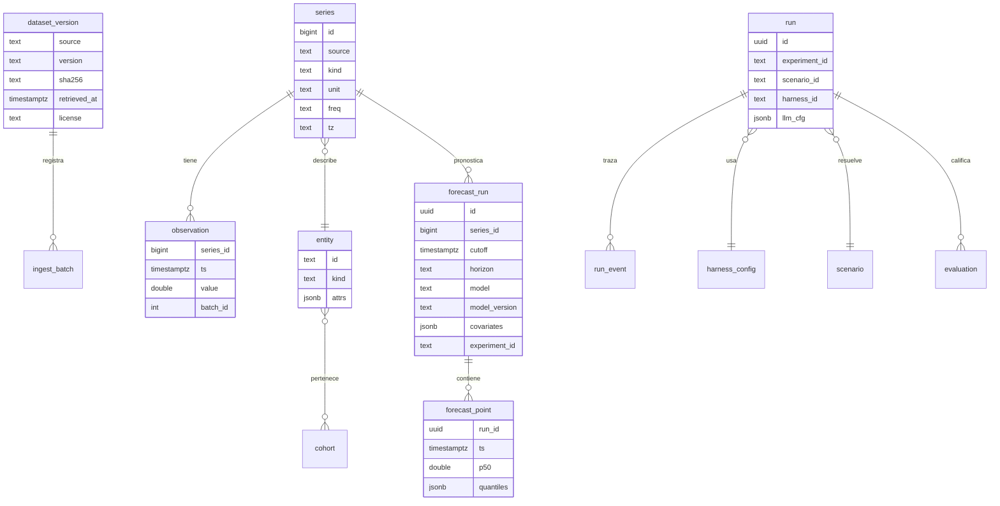

# Proposed: Octavius Energy Lab

Propuesta de arquitectura, fase 0, 2026-11-10. Parte de `current-state.md`, y las decisiones están registradas en `docs/decisions/`.

## Principios

1. **Extender, no replicar.** El laboratorio es Octavius más plugins y configuración. No se crea un chat paralelo ni un backend paralelo.
2. **MCP es la frontera.** Todo lo de energía (datos, forecasting, semántica) entra como servidor MCP, igual que el plugin de dominio actual.
3. **Un runtime, varias configuraciones.** Harness A y Harness B son dos archivos de configuración del mismo orquestador, no dos códigos.
4. **El evaluador queda fuera del agente.** El runner de evals llama a Octavius por su API, calcula el ground truth por su cuenta y su juez usa otro proveedor.
5. **Opt-in para lo caro o restringido:** el perfil Full, TimesFM 3.0 (licencia no comercial) y Auto Ontology (dependencias de NIM).

## Vista de componentes



## Datos

### Fuentes

| Rol | Fuente | Carga |
|---|---|---|
| Principal | CENACE: demanda horaria por región del Sistema Eléctrico Nacional, pronóstico oficial de demanda y PML por nodo | Los detalles de acceso se documentan en `docs/data/cenace.md` tras la verificación |
| Secundario | Low Carbon London: lecturas cada 30 minutos de 5,567 hogares y `Tariffs.xlsx` | Descarga directa del London Datastore, CC BY 4.0 |
| Desarrollo | UCI ElectricityLoadDiagrams20112014, CC BY 4.0 | Solo para pruebas del pipeline |
| Clima | Por decidir tras la verificación: SMN o Open-Meteo con pronósticos archivados | Separar el clima pronosticado del observado (ver la frontera temporal) |

Se excluye el clima de Dark Sky de Kaggle porque su licencia de redistribución no está clara.

### Modelo genérico por serie

Todas las fuentes se normalizan a un mismo modelo, de modo que el plugin, el forecasting y los evals no dependen de la fuente.



- **`kind`:** demanda real, demanda pronosticada por CENACE, PML, consumo de hogar o clima.
- **`entity`:** una región del Sistema Eléctrico Nacional, un nodo o un hogar.
- **`cohort`:** sistema o región para CENACE; Std o dToU, y ACORN si lo permite su uso, para Londres.

### Almacenamiento

- **Base de datos:** una propia, `energy_lab`, en el servicio PostgreSQL existente. Hoy está en el perfil `local`; se habilita en el perfil `lab`. No se mezcla con la base del plugin retail, que de todos modos queda fuera del fork.
- **Esquemas:**
  - `raw`: staging de COPY.
  - `core`: series, entidades y observaciones.
  - `agg`: agregados horarios, diarios y por cohorte.
  - `forecast`: corridas y puntos de pronóstico.
  - `lab`: experimentos, corridas, eventos y evaluaciones.
- **Particionamiento:** `core.observation` se particiona por rango mensual con el particionamiento nativo de PostgreSQL. TimescaleDB solo entraría si el benchmark E1 muestra un problema que el particionamiento nativo y los agregados no resuelven. Se registra como decisión (ADR-0003).
- **Roles:**

| Rol | Permisos |
|---|---|
| `lab_migrator` | DDL |
| `lab_ingest` | Escribe en `raw` y `core` |
| `lab_agent` | Solo lectura sobre vistas de `agg` y `core`, `statement_timeout` a nivel de rol y límite de filas en el sqlguard |
| `lab_forecast` | Escribe en `forecast` |
| `lab_eval` | Lee todo y escribe en `lab` |

- **Migraciones:** archivos SQL numerados (`db/migrations/NNNN_*.sql`) con una tabla `lab.schema_migrations` y un runner pequeño. Va en línea con el estilo actual del repo, que no usa Alembic para Postgres.
- **Ingesta:**
  1. Descarga con sha256 propio.
  2. COPY en streaming por archivo o partición.
  3. `ingest_batch` con estado, que hace la ingesta reanudable.
  4. Upsert idempotente sobre `(series_id, ts)`.
  5. Conteos verificados contra la fuente.
- **Perfiles:**
  - `smoke`: pocos días y pocas series, que caben en el repo como fixture.
  - `demo`: configurable por número de series y rango de fechas.
  - `full`: opt-in con estimación previa de disco, RAM y duración, y confirmación explícita.

## Inferencia

- **Default:** Ollama en contenedor con GPU (perfil compose `gpu`), con `qwen3:8b` en Q4_K_M de 5.2 GB, que cabe con holgura en 16 GB de VRAM.
  - Octavius ya habla OpenAI-compatible, así que solo cambia `SAPTIVA_BASE_URL`.
  - vLLM queda como alternativa documentada, porque en Blackwell sm_120 tiene riesgo de compatibilidad.
- **Modo non-thinking:** se pasa `chat_template_kwargs.enable_thinking=false`, o el mecanismo equivalente de Ollama. Hay que verificar en la fase 2 que el cliente lo deja pasar.
- **Registro:** cada corrida guarda modelo, digest, cuantización, temperatura, top_p, semilla, max_tokens, thinking, motor y su versión.
- **Remoto:** la API de Saptiva sigue disponible para quien no tenga GPU, y para el juez si se elige un proveedor distinto al del sistema medido.

## Forecasting (plugin `forecasting`)

- **Tools MCP**, con nombres finales adaptados a la convención de Octavius en la fase 3:
  - `list_series`
  - `get_series_metadata`
  - `forecast_series`
  - `detect_peaks`
  - `compare_forecasts`
  - `explain_forecast`
- **Contrato:** cada forecast guarda serie, `cutoff`, horizonte, frecuencia, modelo y versión, covariables con su origen (observada o pronosticada), cuantiles, duración y `experiment_id`.
- **Frontera temporal:** el plugin rechaza cualquier dato con `ts > cutoff` en el contexto. Las covariables futuras solo se aceptan si son pronósticos emitidos antes del `cutoff`.
- **Modelos:**
  - TimesFM 2.5, Apache-2.0, por defecto.
  - Seasonal naive y media móvil estacional como baselines.
  - El pronóstico oficial de CENACE como baseline externo.
  - TimesFM 3.0 detrás del flag `FORECAST_ENABLE_TIMESFM3`, con aviso de licencia no comercial, sin hacer mirror de pesos y sin entrar en las imágenes publicadas.
- **Backtesting:** rolling-origin con MAE, WAPE y MASE, y pinball loss o CRPS aproximado cuando haya cuantiles.

## Capa semántica (plugin `semantic-adapter`)

- **Interfaz:** expone `search_terms`, `resolve_concept` y `check_answerable`, inspiradas en las tools del MCP oficial de Auto Ontology.
- **Backend local, por defecto:**
  - Un catálogo YAML versionado con conceptos como consumo, demanda pico, hogar, región, tarifa dinámica, horizonte, observación histórica, valor pronosticado y real contra pronóstico.
  - Cada concepto se mapea a vistas y columnas permitidas.
  - Es la evolución del catálogo YAML de métricas que ya usa Octavius.
- **Backend Auto Ontology, opt-in:** un proxy a su servidor MCP. Requiere desplegar su backend, ingesta y Postgres con pgvector, más modelos de LLM, embeddings y reranker, ya sea NIM o OpenAI-compatible. Se evalúa en la fase 4 sin bloquear la POC.
- **Flag:** `ENERGY_SEMANTIC_LAYER=off|local|auto_ontology`.

## Harness

`harness/*.yaml` lo carga `HarnessConfig` y lo inyecta en el orquestador.

```yaml
id: harness-b
llm: {model: qwen3:8b, temperature: 0, thinking: false, max_tokens: 2048}
budget: {max_rounds: 4, max_tool_calls: 8, timeout_s: 60}
tools: [energy_data.*, forecasting.*, semantic.*]
components:
  tool_policy: on          # intención → tools permitidas
  schema_validation: on    # args y outputs contra JSON Schema
  temporal_guard: on       # cutoff obligatorio, rechaza ts > cutoff
  semantic_grounding: local
  provenance: on           # cada cifra con query_id / forecast_run_id
  output_verification: on  # claims numéricos contra evidencia
  recovery: on             # reintento acotado ante error de tool
```

| Componente | A | B | Nota |
|---|---|---|---|
| Tool calling | sí | sí | Mismo catálogo y mismo presupuesto en ambos (evita el tool availability bias) |
| SQL de solo lectura, sqlguard y timeouts | sí | sí | Seguridad básica, nunca se desactiva |
| Formato de respuesta común | sí | sí | |
| Traza mínima | sí | sí | B guarda la traza completa, pero A también se mide igual desde fuera |
| Política de selección de tools | no | sí | |
| Validación de esquemas | no | sí | |
| Frontera temporal en el harness | no | sí | El plugin de forecasting siempre valida su propio contrato, así que la ablación mide la capa del harness |
| Grounding semántico | no | sí | |
| Provenance | no | sí | |
| Verificación numérica de la salida | no | sí | |
| Recuperación de errores | no | sí | |

Las ablaciones se hacen apagando un componente de B a la vez.

**Pendiente de decidir en la fase 5:** si la frontera temporal del plugin también se puede apagar en un entorno de prueba aislado, para medir el leakage "crudo".

## Evaluación (`evals/`)

- **Escenarios:** YAML versionados por categoría: data retrieval, forecasting, analytical reasoning, temporal integrity, unanswerable y ambiguous.
- **Ground truth:** SQL de referencia que corre con el rol `lab_eval`, cálculos deterministas y etiquetas manuales revisadas. Nunca se calcula con el harness.
- **Generalización de los evals existentes:** separación entre pila dev y pila sellada, pass^k, bootstrap pareado y juez de otro proveedor.
- **Métricas:** task success, tool selection accuracy, SQL correctness, forecast correctness, temporal leakage rate, grounded answer rate, false alarm rate, latencia p50/p95 y tokens/VRAM.
- **Análisis de los siete sesgos:** por cohorte y con intervalos de confianza.
- **Exportación:** CSV, JSON y Parquet desde `lab.*`.

## Tracking

- **Tablas:** `lab.experiment`, `lab.run`, `lab.run_event` (tool calls, argumentos sin secretos, query_id, forecast_run_id, latencias, errores) y `lab.evaluation`.
- **OTel:** se reutiliza el stack existente para spans y latencias. No se agrega Langfuse salvo que el tracking ligero resulte insuficiente.

## UI

- **Nuevo `chart_type: forecast`** en el registro del canvas, con histórico, línea de corte, horizonte y bandas de cuantiles. Los valores reales solo se muestran en modo evaluación.
- **Ruta `/evals`** en `apps/web`: comparación entre A y B con selector de escenario, trazas, ejemplos de falla y un distintivo **MEDIDO** o **REPLAY**.
- **Sin acoplar el frontend al dominio:** las vistas consumen `AnalyticsResponse` y los artefactos `lab.*`, que son genéricos.

## Despliegue local

- **Arranque:** `docker compose --profile lab --profile gpu up`.
- **Servicios existentes:** web, backend, mongodb, redis y postgres.
- **Servicios nuevos:** energy-data, forecasting (GPU), semantic-adapter y ollama (GPU).
- **Restricción de RAM:** el host tiene 14 GB y la VRAM de 16 GB se comparte entre Ollama y TimesFM. Weaviate, MinIO, el dashboard y los plugins que no se usan quedan fuera del perfil `lab`.
